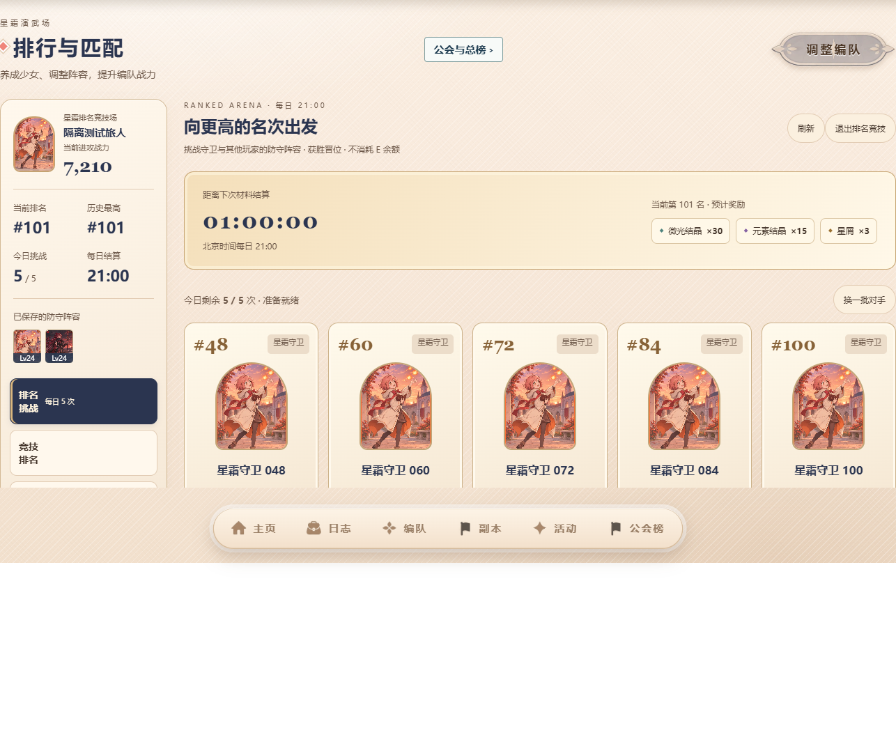
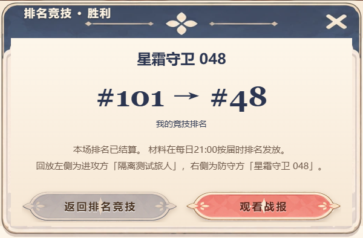
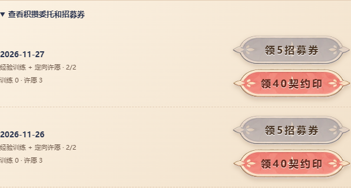
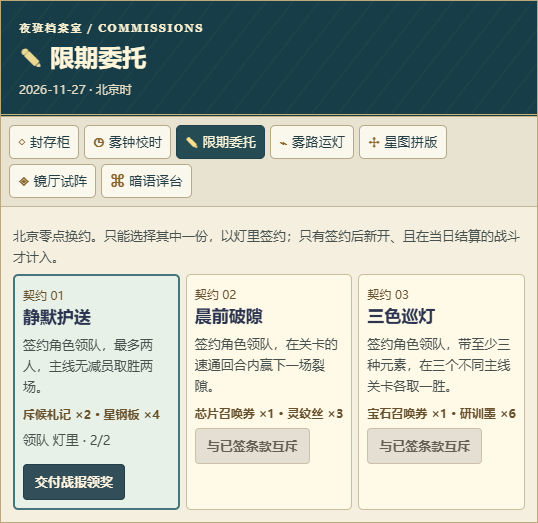
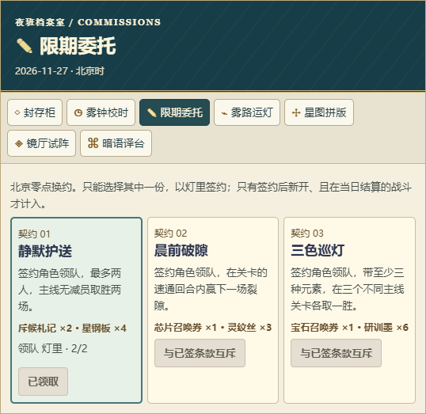

# 合并复审：排名竞技、卡牌培养与港口更新

**唯一合并入口：[上游 PR #2](https://github.com/kennponn/ultrarouter-card-game/pull/2)。** 此分支包含 #1 的排名竞技、#2 的培养与原创玩法、#3 的船长／邮件／副本与榜单，以及本报告列出的复审修复。无需再合并 #1 或 #3；不包含独立的 #4。

## 1. 基线、方法与合并证明

| 对象 | 固定值 |
| --- | --- |
| 用户提供的旧目录与上游 `main` | `7fbc923711ebe7d30c8f737c13b2687124ac1e83`，两者树均为 `f5b65653e5dbc04ddb07257b68ce44aa2a83329c` |
| 三条原始分支 | #1 `424ab77d9015017801fdfbc48d6210f01cad2ab6`；#2 `88c7acd01ac5b6626933d939a9a91bf18a11c67f`；#3 `b5be172883711832929a505b96cf124761619b90` |
| 合并及修复 | `33b4cca41c6ac408184fa8678d35467364ba3673` 的两个父提交是 #3 和 #1；其后的 `0717d7409e09f066d3f41e00af92b9c2bdc5fe29` 包含修正后的验收用例 |
| 测试入口 | [合并候选 CI](https://github.com/1810551251/ultrarouter-card-game/actions/runs/45935421382)：`game-source`、`consolidated-database`、`same-database` |

对三条原始分支分别运行 `git merge-base --is-ancestor <原提交> <候选>`，三次均返回 0。因 `7fbc923` 是候选的祖先，`git merge-tree --write-tree 7fbc923 <候选>` 返回的树与候选 `^{tree}` 相等。对该固定上游版本，这证明合并不需要额外的冲突解决，且一次合并包含三条分支的修复后内容。它不代替维护者的审批，也不预测上游改变之后的冲突。未修改旧目录、未强推、未部署。

**验收结果：三项 CI 作业全部通过。** [数据库原始日志](https://github.com/1810551251/ultrarouter-card-game/actions/runs/45935421382/job/140297398066) 按引擎分别记录通过的 5 组：迁移／换位／领奖、封禁、注销、退榜、契约分流。此处的 15 组不计外层汇总用例。

| 实测引擎 | 迁移与天梯 | 账号席位 | 契约分流 |
| --- | --- | --- | --- |
| SQLite 3.45.1 | 1/1 | 3/3 | 1/1 |
| MySQL 8.0.46 | 1/1 | 3/3 | 1/1 |
| PostgreSQL 16.15 | 1/1 | 3/3 | 1/1 |

证据分层：数据库与 Go 断言验证真实持久化结果；浏览器截图只展示真实游戏页面在合成响应下的状态；另有 #3 的浏览器直接连接一次性数据库适配器的验收。所有图片仅由浏览器写出，没有读取像素、打开图片或执行 OCR。

## 2. PR #1：排名竞技

| 评审问题 | 机制与可否证的验收条件 |
| --- | --- |
| 封禁、注销占住榜首并领奖 | 在 SQL 排名门锁内查出失效账号，排除其新增结算，并移出正名次区间；有效席位按原先顺序补齐。测试分别从「失效前第 1／有效第 2」起步，覆盖封禁、软删除和自愿退榜。必须观察到第 2 升到第 1、退出者新奖励 0 行、升位者当晚附件 `120/60/20`，推荐 5 位且不含失效账号。 |
| 明确如何撤回参赛 | 排名挑战页有「退出排名竞技」和独立确认。退榜停止接受挑战，不撤销已结算权益；可重新报名，回到榜尾。数据库测试保留原挑战用量（已用 4 次，重报仍剩 1 次）和冷却时间。免费模式只有名次范围限制，不做战力差限制。原余额模式仍要求每场主动匹配或房间双方分别准备，战力差不超过较低方的 20%。 |
| 当前页临时同步失败 | 只有当前页、当前标签、当前序号、当前会话的请求能更新页面；其中 `Store.refresh()` 返回空值时显示重试。Node 模拟空值后点重试，Edge 则拦截一次真实页面的资料请求并返回 429，重试后恢复 5 张对手卡。 |
| 换账号后显示旧战报 | 提交前记录会话序号，等待动作及页面刷新后再次核对；旧会话结果不得写入回放或弹窗。回归先验证正常战报显示，再把切换放在 `await renderArena()` 内，断言弹窗保持关闭。私人战报接口另外拒绝第三方账号。 |
| 全榜锁下加载完整候选存档 | 正名次连续时，区间 `[低位, 高位]` 扣除本人后有 `高位 − 低位` 个槽。把这些槽分成至多 5 个不相交的非空区间，每段抽一个，把越过本人位置的槽位加一。按 `position` 唯一索引一次读最终位置；候选区间增大也不会多读防守档。例：第 101 名、总榜 102 人时，旧写法会读区间 `40…102` 的 62 份候选防守档，新写法至多 5 份。这里是**行数上界**，不是生产延迟测量；前 50 榜单和自己的快照是独立查询。 |
| 测试把内部字段纳入回执比较、后续目标错位 | 比较首次响应与重放的公开 JSON，并独立读 `used=1`。晋位序列以数据库当前 `position` 取对手，不假定 NPC ID 等于名次。断言 101→100→99，过 21:00 的晋位不改变当晚已按第 100 名冻结的 `40/20/5`，05:00 恢复 5 次，满背包不消耗资格，两路并发仅一路领成功，E 余额不变。 |

时序条件：到期结算和名次变动共享 SQL 门锁，所以晚于截止的换位不影响已到期名次；每个 `(user_id, day)` 唯一。已观测到失效的账号不生成新行。宿主没有向游戏提供历史封禁时间，补结算时不能重建从未记录过的账号状态；对仍有效玩家沿用补结算前保存的名次，回收后下一次结算用新名次。排名领取的背包更新、领用标记、回执同事务提交，失败回滚。

| 排名界面（Edge，合成响应） | 排名界面（Edge，合成响应） |
| --- | --- |
| 1. 桌面推荐与倒计时  | 2. 429 后主动重试  |
| 3. 确认回执后的晋位  | 4. 素材及结算日  |
| 5. 390px 手机对手卡  | 6. 退榜确认  |

## 3. PR #2：领奖分流与审计

旧冲突来自校验及执行把 `contract_claim` 优先派给新派遣。修复后，该旧指令和成长页已用的 `daily_contract_claim` 同属每日成长资格；派遣只用 `dispatch_contract_claim`。这不是按当前有没有签约猜玩家意图。每日契约生成邮箱附件，派遣按当前已完成签约直接发放指定工料；两者不共用领取标志。

| 经 `controller.ApplyGachaAction` 的操作 | 核对的数据库结果 |
| --- | --- |
| 无派遣合同，领取当日成长契约 | `contract_claim` 成功，生成一封 `40` 契约印附件；领取附件后背包 `+40` |
| 无派遣合同，补领前一日成长契约 | 独立产生第二封 `40` 契约印附件；共 `+80`，仍无派遣签约 |
| 过期派遣日期与当日完成的护送合同 | 旧日期拒绝；当日 `dispatch_contract_claim` 成功，`field_notes +2`、`gear_plate +4`，契约印不变 |
| 重放原 UUID／更换 UUID／使用每日别名 | 原 UUID 返回已存回执；新 UUID 不能重领；切换每日别名也不能生成第二封信。过滤船长自动邮件后恰有两封已领的每日契约信 |
| 发布审计 | 三份既有测试样例的 SHA-256 与 `git show :<path>` 字节逐一相符，保留 LF 固定规则和原类别。`python scripts/audit-release.py` 检查 238 个文件，仅命中 4 个已有人工复核样例。没有关闭扫描或放宽规则 |

| 成长页 | 密务厅 |
| --- | --- |
| 7. 当日和历史契约是不同日期  | 8. 限期委托的独立领奖按钮  |
| | 9. 服务器回执后禁用  |

[截图原始 DOM 结果](screenshots/browser.json)：Edge `156.0.4314.50`，桌面 `1366×900`、手机 `390×844`，根文档 `scrollWidth` 分别等于 `1366` 和 `390`，页面异常均为 0。四种动作按预期发送，截图使用的游戏文件与 `0717d74` 一致（两次提交间只改了数据库测试）。截图不能证明扣料或入账，数据库日志才是依据。

## 4. PR #3：在新合并分支复跑

[合并后的同库验收](https://github.com/1810551251/ultrarouter-card-game/actions/runs/45935038885) 使用 SQLite `3.45.1` 和 Chromium `156.0.8078.108`，旧版先生成档案，合并版在原库迁移后实际通关 `res_manifest`。升级前后原档资产逐项相等，浏览器显示原四人队；本轮原始档案行 SHA-256 是 `54a2d522c1bb3e3ffd60db6dac3c1bd95d29e9985d14a37dc89f13f6b8fb2fcc`。

| 观察点 | 实测 |
| --- | --- |
| 原体力规则、日次数、船长 XP | `118→112`、`0→1`、`0→6` |
| 斥候札记／历练手记 | 通关前 `0/0`，通关待领时仍 `0/0`，信中 `2/1`，领取后 `2/1` |
| 双击、刷新、重放、新请求 | 双击只发送 1 个领取请求；刷新和重放仍 `2/1`；新请求返回 `ALREADY_CLAIMED`，新增回执行 `0`，有效领取回执行 `1` |

原有 [#3 复审报告与三张同库截图](../pr-3-evidence/README.md) 保留；本轮实际截图与 JSON 随 CI 的 `sqlite-review` 产物提供。

## 5. 如何复验

源代码检查：`npm test` 本地通过 100 项 UI 检查及 129 项 Node 测试；`npm run test:release` 的等价 unittest 命令通过 19 项；发布审计通过。CI 的 `game-source` 在受限容器中再跑 UI 项。三库执行同一组 Go 验收并记录引擎版本，见 CI 的 `consolidated-database` 作业和 `database.txt` 产物。旧档的两阶段流程见 `same-database` 作业。

```sh
out=$(mktemp -d)
sh "${GACHA_BUILD_WRAPPER:-scripts/build-half-cpu.sh}" --run --rm -e GOMAXPROCS=1 \
  -v "$PWD:/src:ro" -v "$out:/out" ubuntu:24.04 \
  sh /src/docs/pr-2-evidence/harness/run.sh
```

Go 适配器只给测试提供账号行、受控会话上下文和数据库连接。实测使用仓库原样的游戏模型、控制器、事务、迁移示例和真实数据库引擎，不接入生产认证、钱包缓存或真实账号。维护者可在自己的兼容宿主用 `TestGachaAuthorityDatabaseMatrix` 复跑完整集成矩阵。所有截图及测试适配器位于 `docs/`，不进入游戏发布压缩包。
