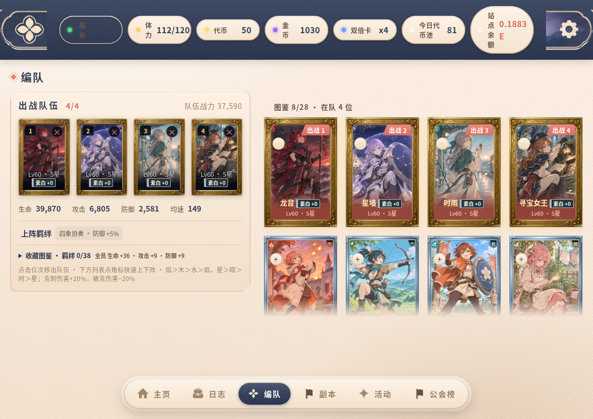
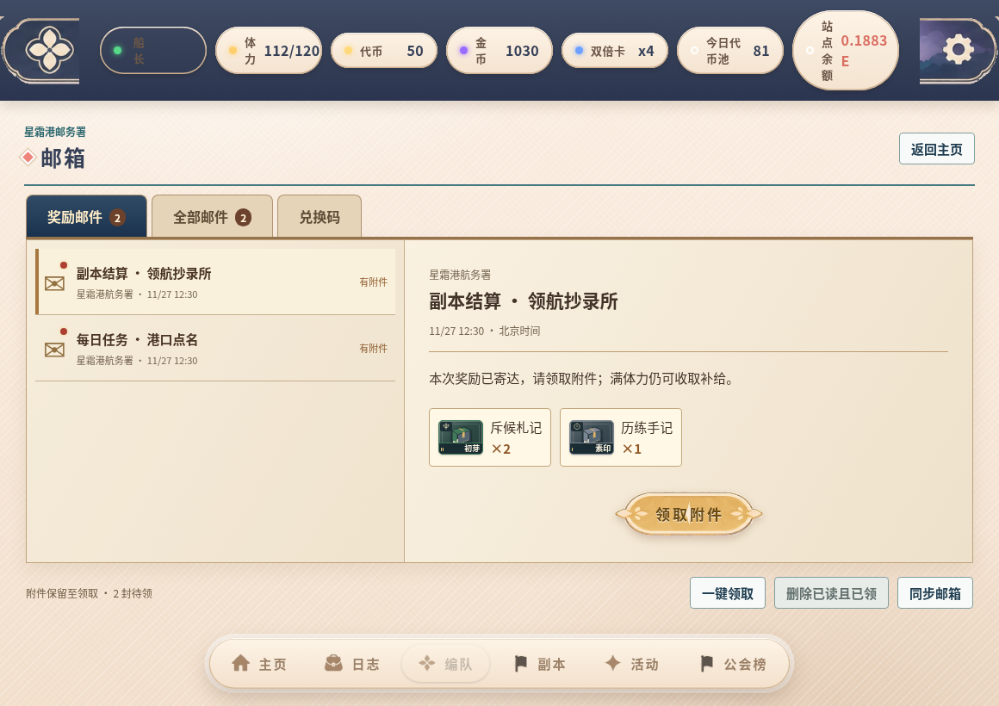
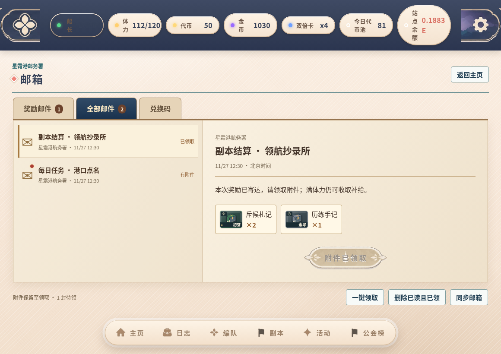

# PR #3 更新验收公告：老玩家返港与副本邮件

**结论：维护者要求的三项验收在 SQLite 3.45.1 上全部通过。** 旧版生成的存档能够进入新版；副本通关先寄信、领取再入包；同一封邮件在双击、重放原请求、刷新后换新请求三种情形下都只到账一次。

[复审要求](https://github.com/kennponn/ultrarouter-card-game/pull/3#issuecomment-7207730683) · [通过的 CI 运行](https://github.com/1810551251/ultrarouter-card-game/actions/runs/45931779894) · [数据库原始结果](results.json) · [浏览器原始结果](browser.json)

## 一、老玩家返港

旧版建库后，用测试编队实际打赢 `s1`，读取旧版结算后的存档并关闭进程。新版对**同一文件**执行仓库提供的迁移，在首次读取档案之前校验原始存档行：SHA-256 两端相同，为 `aa0e4adbfe3ae5a7472b0604238f1cbf66055af7470dd1a33e3ca8d5d19ede91`。随后用浏览器进入新版首页并打开编队。

| 核对项 | 旧版退出时 | 新版首次读取 |
| --- | --- | --- |
| 角色 | 8 张，上阵顺序 `c04 / c07 / c09 / c03` | 8 张；所有角色的等级、星级、经验、碎片与原档逐项相同 |
| 上阵编队 | 四人均为 Lv.60、5 星；`c04` 有 17 碎片 | 四个位置均显示原角色、等级及星级；17 碎片保留 |
| 金币 / 体力 / 代币 / 双倍卡 | 1030 / 118 / 50 / 4 | 1030 / 118 / 50 / 4 |
| 招募券 / 契约印 / `mat_r` | 12 / 9 / 18 | 12 / 9 / 18 |
| 已通关关卡 / 最佳星数 | `s1` 已通关，3 星 | `s1` 已通关，3 星 |

**图 1：** 升级后使用同一存档打开编队，供核对四个上阵位置。



## 二、通关寄信与领取对账

用这份档案实际打赢「领航抄录所」`res_manifest`，以本局签发的 `run.ID` 查找唯一一封 `battle:<run.ID>` 邮件。此战体力 **118 → 112**，船长经验 **0 → 6**，该副本当日已用次数 **0 → 1**。本次没有调整副本消耗或每日次数规则。

| 同一局、同一封信 | 斥候札记 | 历练手记 |
| --- | ---: | ---: |
| 开战前背包 | 0 | 0 |
| 胜利结算后，未领取，数据库背包 | 0 | 0 |
| 邮件附件 | 2 | 1 |
| 首次领取后，背包 | 2 | 1 |
| 刷新后新请求被拒、原请求重放、再读数据库 | 2 | 1 |

两种物品分别满足 `结算后背包 = 开战前背包`、`领取后背包 − 结算后背包 = 附件`。领取意图只选邮件 ID，不提交奖励数值。

**图 2：** 战斗结算生成的待领邮件，可对照两种附件及数量。



## 三、重复领取只记一笔

| 复现动作 | 实际观察 |
| --- | --- |
| 浏览器双击领取，暂缓返回第一次真实响应 | 只有 1 个领取请求；回包前按钮禁用，页面背包仍是 `0 / 0`；回包后为 `2 / 1` |
| 重载整个页面，再点同一封信 | 重新从数据库读取档案，邮件已领，按钮禁用；再点不出网 |
| 刷新后主动以**新请求 ID**向服务端领同一封信 | 服务端拒绝；浏览器再读档仍为 `2 / 1` |
| 将首次领取的**原请求 ID**再次交给 Go 游戏模型 | 返回与首次相同的回执；独立 SQL 查询显示背包仍为 `2 / 1`、同一封信已领 |
| 再用另一个新请求 ID 领取、查询操作表 | `ErrGachaMailUnavailable`，该请求有 **0 条**回执；玩家操作表从领取前的 2 条变为全部重试后的 3 条。按首次请求 ID 找到唯一新增回执，回执中的背包为 `2 / 1` |

**图 3：** 刷新后再次打开同一封信。浏览器全程读取档案 3 次，页面脚本错误 0 个。



三张图均由浏览器当场生成，未读取像素或使用 OCR。断言依据是游戏模型、数据库查询、DOM 和请求记录。[早期仅验证前端的夹具](frontend-fixture.md)不计入本次结果。

## 版本与复现

| 项目 | 实际使用 |
| --- | --- |
| 旧版 | `7fbc923711ebe7d30c8f737c13b2687124ac1e83`，与提供的旧目录及 PR base 一致 |
| 新版 | `d5271c30f34faee8ea88866b3e6548623e11e503`，直接编译该提交的游戏模型，同提交的 HTML、JS、样式和资源供浏览器使用 |
| 测试提交 | [`3e96d0b`](https://github.com/1810551251/ultrarouter-card-game/tree/3e96d0b7733b0e394b4297b3b57fb3c9a3b75c72/docs/pr-3-evidence)，CI 的 `same-database` 作业中，`TestGachaPR3ProduceLegacy` 与 `TestGachaPR3UpgradeAndClaim` 均为 `PASS` |
| 环境与范围 | GORM / SQLite 3.45.1、Chromium 156.0.8078.108、一次性隔离容器。测试适配器提供宿主表与一次性会话，游戏迁移、战斗、发信、入账和重放均使用仓库实现。结论针对游戏升级及领取流程；未使用生产登录服务、真实账户或其他数据库引擎。 |

在含上述提交历史的 Linux 仓库根目录和隔离 Docker 环境执行：

```sh
out=$(mktemp -d)
sh "${GACHA_BUILD_WRAPPER:-scripts/build-half-cpu.sh}" --run --rm -e GOMAXPROCS=1 \
  -v "$PWD:/src:ro" -v "$out:/out" golang:1.25-bookworm \
  sh /src/docs/pr-3-evidence/harness/run.sh
ls "$out"
```

旧版战利品可能随每次真实战斗变化；通过条件是**同一次运行**升级前后逐项相等。两个测试进程共用一个全新库，随后随容器销毁；只保留脱敏数字和三张截图。
