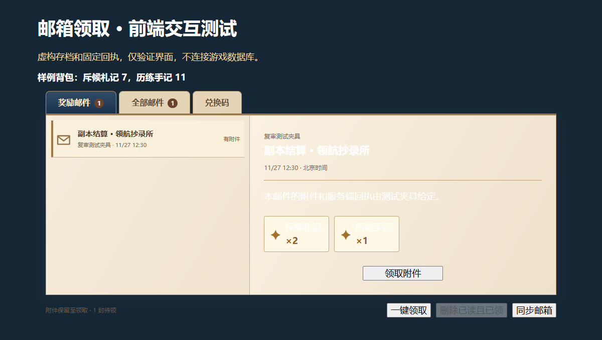
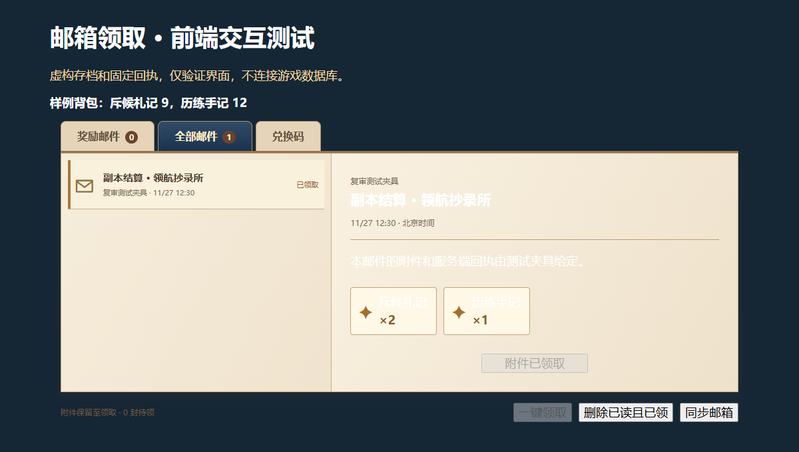

# 历史记录：仅前端夹具（旧轮次）

此页保留早期测试的原始范围，不代表当前验收结论。[返回最新同库验收报告](README.md)。

针对[维护者的三项验收要求](https://github.com/kennponn/ultrarouter-card-game/pull/3#issuecomment-7207730683)。**本轮通过的是前端防重复提交；真实旧档迁移及数据库单次入账尚未验收。** 未改动副本体力、挑战次数或任何游戏逻辑。

| 项目 | 本次使用的版本或环境 |
| --- | --- |
| 旧版 | `7fbc923711ebe7d30c8f737c13b2687124ac1e83`，给定旧目录的干净检出，与 PR base 相同 |
| 被测游戏代码 | `d5271c30f34faee8ea88866b3e6548623e11e503`，PR #3 的功能提交 |
| 浏览器实测 | Edge `156.0.4314.50`，Node `v24.21.0`，真实邮箱脚本与样式、隔离夹具回执 |
| 本轮实际使用的数据库 | **无**。没有可运行两个版本的兼容宿主和受限测试容器。下文 SQLite 为待跑目标，不是本次测得的数据库类型。 |

## 验收对照

| 评论要求 | 已取得的证据 | 尚不能据此下的结论 |
| --- | --- | --- |
| ① 老玩家升级后仍能进入，角色与资源保留 | 核对了旧版提交；准备了在旧版创建非默认存档、原库升级后逐项对账的用例 | 没有在兼容宿主运行旧版和新版，也没有验证真实会话进入升级后的游戏 |
| ② 通关寄信，领取增量等于附件 | 邮箱页面接收固定附件及测试回执，观察到两个材料的显示增量为 `+2、+1`，回包前为 `0、0` | 夹具直接给出附件和领取后存量，不能证明 Go 战斗结算实际寄信或数据库已入账 |
| ③ 连点、刷新重领只到账一次 | 真浏览器双击，只送出 1 个请求；真实页面刷新后，夹具返回已领状态，再点没有新请求 | 前端按钮挡住了第二次提交，不等于数据库能抵抗两个都已到达的请求 |

## 浏览器原始记录

选择与「领航抄录所」掉落类型相同的固定附件：斥候札记 ×2、历练手记 ×1。夹具起始背包分别是 7、11。先挂起领取响应并双击；释放响应后查看全部邮件；随后执行真正的页面重载，再尝试点击同一封邮件的按钮。

| 观测时点 | 斥候札记 | 历练手记 | 邮件已领 | 领取按钮 | 累计领取请求 | 累计读取档案 |
| --- | ---: | ---: | --- | --- | ---: | ---: |
| 领取前 | 7 | 11 | 否 | 可用 | 0 | 1 |
| 双击，回包仍挂起 | 7 | 11 | 否 | 禁用 | 1 | 1 |
| 第一次回包后 | 9 | 12 | 是 | 禁用 | 1 | 1 |
| 刷新、再次尝试点击 | 9 | 12 | 是 | 禁用 | 1 | 2 |

浏览器未报脚本错误。[机器可读记录](browser-results.json) · [探针源码](mail-probe.cjs)。探针只拦截虚构域名，未连接游戏服务。已安装 Edge 和可由 Node 解析的 `playwright-core` 时，从项目根目录执行 `node docs/pr-3-evidence/mail-probe.cjs` 可重写记录和截图；`node --v8-pool-size=1 --test --test-concurrency=1 tests/mail-check.js` 本次另有 2 项通过。

**图 1：领取前。** 对照邮件附件和顶部两个材料的起始值。



**图 2：刷新后。** 对照相同邮件的已领状态、不可用的按钮，以及两个回包后的计数。截图由浏览器直接写出，未读取或分析像素；数值来自独立 DOM 和请求计数断言。



## 在隔离宿主补做同库验收

提供两个**尚未运行**的 Go 用例。不要把新版创建的 JSON 删除 `mailbox` 字段当作旧档，也不要用两个各自初始化的空库比较。该流程在旧版实际结算一次，停止旧进程后把同一个 SQLite 测试卷交给新版；两个阶段使用相同游戏时钟，避免自然恢复干扰体力差值。

1. 准备两个兼容的宿主测试镜像，分别包含表中两个提交的游戏代码及其原有 `model` 测试 helpers。两者均加入[共享测试文件](shared_test.go.example)；仅旧版加入[旧档生成用例](legacy_test.go.example)，仅新版加入[升级与领取用例](current_test.go.example)。在宿主 `model` 包中移除文件名末尾的 `.example`。使用已批准的镜像或用共享半 CPU 包装器构建；不用生产镜像、用户库或会话。
2. 准备一个**空、可写、仅用于本次测试**的卷，两个测试容器均挂到 `/pr3-state`。旧版拒绝覆盖已有库。把下列占位符替换为实际隔离环境参数，在宿主模块根目录分别执行；共享构建机的 `WRAPPER` 应指向其 `GACHA_BUILD_WRAPPER`。

   ```sh
   sh "$WRAPPER" --run --rm -e GOMAXPROCS=1 -v "$TEST_VOLUME:/pr3-state" -w "$HOST_MODULE" "$OLD_IMAGE" go test -p 1 -parallel 1 -count=1 -v ./model -run '^TestGachaPR3ProduceLegacy$'
   sh "$WRAPPER" --run --rm -e GOMAXPROCS=1 -v "$TEST_VOLUME:/pr3-state" -w "$HOST_MODULE" "$NEW_IMAGE" go test -p 1 -parallel 1 -count=1 -v ./model -run '^TestGachaPR3UpgradeAndClaim$'
   ```

3. 旧版用测试 helper 准备强队和非默认余额，走旧版 `StartGachaRun` / `FinishGachaRun` 通关 `s1`，从旧版重新读档取对账基线。新版启动后、首次加载档案前，验证同一行存档摘要；加载后逐项比较角色 ID、等级、星级、经验、碎片、编队、金币、体力、代币、双倍卡、招募券、契约印、材料、背包宝石及关卡记录。**模型档案成功不等于真实网页登录成功**：还应使用同一测试账号在隔离站点打开主页和编队，核对持有角色并留图。
4. 在该档打赢一次 `res_manifest`。用本次 `run.ID` 找到 `battle:<run.ID>`，不能拿点名邮件或礼包代替。记录 `B`（开战前背包）、`S`（结算后重读背包）、`A`（该封附件）、`C`（首次领取）。验收条件是 `S=B` 且 `C−S=A`，逐物品成立；该关实际消耗应为 6 体力。
5. 重发**同一** `request_id`，应返回原领取回执；重新读取档案，再用**新** `request_id` 领同一邮件，应收到 `ErrGachaMailUnavailable`。两次后都独立读档，断言材料仍为 `C`、邮件保持已领。用例输出 SQLite 实际版本和各阶段数值。复审只贴这些数值、提交和测试结果，不贴存档、账号、连接串或凭据。

**合并判断：** 三项服务端验收均需隔离宿主的实际记录。当前两张图和四行浏览器数据只支持前端结论。
