# 星霜少女更新公告｜船长成长、邮箱礼包、副本与排行榜

更新日期：2026 年 11 月 27 日。本次更新内容如下。

## 一、船长成长与每日任务

- 新增船长等级、当前经验、升级进度条；主页头像旁直接展示，点击头像打开船长资料。
- 船长经验来源调整为 **实际消耗 1 点体力获得 1 点经验**，以及**每日任务奖励**。免费训练、兑换礼包和主线里程碑不额外提供船长经验。
- 伙伴等级上限随船长等级提升，最高 **150 级**。已有伙伴的历史最高等级继续保留。
- 每日任务共 **5 项**：港口点名、三程巡航、甲板晨练、向星许愿、整装备航。完成后奖励自动寄送至邮箱。
- 新增三次体力补给，按北京时间开放：

| 补给 | 开放时间 | 奖励 |
| --- | --- | --- |
| 晨航便当 | 09:00–12:00 | 30 体力 |
| 正午炊烟 | 12:00–21:00 | 30 体力 |
| 夜航热汤 | 21:00–24:00 | 30 体力 |

各时段每日限领一次。补给寄入邮箱后可稍后收取，满体力仍可领取附件，超过自然恢复上限的体力保留。

## 二、新增邮箱与兑换码

- 新增「邮箱」：奖励邮件、全部邮件、兑换码三个页签，支持单封领取、一键领取、删除已读且已领邮件。
- 主页与头像资料提供邮箱入口，红点数字显示待领附件数量。
- 每日任务、定时补给、副本星级宝箱、扫荡物资、活动、公会领奖及礼包兑换统一寄送邮件；点击领取附件后，物资才进入背包。
- 新版副本结算中的金币、代币、材料及碎片以附件寄送；领取的碎片累计达到招募门槛时，自动解锁对应伙伴。船长消耗经验、伙伴战斗经验、整卡与独立装备实例、站点额度按对应结算凭据即时到账。
- 附件保留至领取。常规待领附件达到 **200 封**后，自动任务与副本奖励合并到系统汇总邮件，跨日仍可收取。一键领取遇库存容量不足时，所有附件原样保留。
- 新增两组公开启航礼包码，每个账号每种礼包限兑一次，有效期为 **2026-11-27 至 2027-12-31（北京时间）**。

| 兑换码 | 礼包 | 附件 |
| --- | --- | --- |
| `STARFROST2026` | 启航欢迎礼包 | 金币 ×300、体力 ×30、斥候札记 ×2 |
| `VOYAGEGIFT` | 副本探索礼包 | 金币 ×100、研训墨 ×2、辉星铆钉 ×5 |

## 三、副本界面与星级奖励

- 功能名称统一为「副本」，首页、底部导航和船长资料均可进入。
- 按参考关卡设计重做副本界面：全屏地图、沿途关卡、顶部资源栏、章节切换、左下难度选择、右下星级宝箱。
- 共 **4 章、52 个主线关卡**。每章包含剧情 **8 关**、困难 **3 关**、噩梦 **2 关**。
- 三种难度独立记录最高星级，每章每难度设 **3 档星级宝箱**，合计 **36 档**。
- 关卡详情显示解锁条件、敌方信息、三星条件、体力消耗和奖励；已通关关卡保留最高星数。
- 达到三星的剧情、困难和资源关卡支持 **1 次 / 3 次扫荡**，与手动挑战共用当日次数和休整规则。扫荡仅发固定物资，消耗体力正常获得船长经验。

## 四、新增六类资源副本

| 资源副本 | 主要用途 |
| --- | --- |
| 领航抄录所 | 获取伙伴经验书 |
| 浮船锻造厂 | 获取装备强化与升星材料 |
| 潮墨档案库 | 获取研训墨与突破印章 |
| 星砂护商线 | 获取金币与行旅徽记 |
| 深海星锻井 | 获取洗练矿料与觉醒核心 |
| 棱镜打捞湾 | 获取宝石券与芯片券 |

各资源副本每日可挑战 **3 次**。背包物品详情增加对应来源入口。

## 五、公会与排行榜

- 新增公开公会列表、翻页查找、空位展示与快捷加入，保留邀请码入会。
- 新增公会共建：勘绘航标、修整浮桥、点亮引航灯。每日可选一项贡献，三条建设进度共同解锁周奖励。
- 排行榜采用参考主界面的分类侧栏、前三名勋章、名次与指标列、队伍头像、本人排名底栏。
- 提供 **编队战力榜、伙伴收藏率榜、公会周榜、竞技胜场榜、副本星级榜**。
- 副本星级榜统计四章三种难度的最佳星数，最高 **156 星**；重复通关不会重复累计，资源副本与元素裂隙不计入。
- 正式榜显示前 **50 名**与本人名次。点击榜单条目可查看公开编队。
- 新增「演示榜」，使用虚构玩家、公会和队伍展示完整界面；页面明确标注演示数据，可直接打开预览。

## 六、港口活动

- 新增一周 **14 场轮值活动**，每日开放 **2 场**。
- 四类玩法：装船配载、海雾定位、灯阵调配、潮汐择时；题面按周变化。
- 每场最多提交 **3 次**，完成后获得航章与邮件奖励。
- 集齐 **3 / 7 / 11 枚航章**可领取对应集章奖励。
- 活动页增加异闻调查、密务厅、夜巡仪轨入口，保留当前选中的领队。

## 七、界面预览

下列截图使用虚构账号与本地游戏资源，供查看界面与奖励状态。截图不包含真实账号或生产数据。

| 截图 | 入口与说明 |
| --- | --- |
| [主页与船长经验](screenshots/01-home-desktop.png) | 主页头像、等级、经验进度、每日任务和邮箱入口。 |
| [船长个人资料](screenshots/02-captain-profile.png) | 点击头像，查看等级、经验、战力、体力、收藏及副本进度。 |
| [副本地图](screenshots/03-dungeon-story.png) | 四章地图、节点路径、章节切换与底部三种难度。 |
| [困难与星级宝箱](screenshots/04-dungeon-hard.png) | 切换困难难度，查看独立星数和三档星级宝箱。 |
| [星级奖励详情](screenshots/05-star-rewards.png) | 点击宝箱查看达标星数、奖励和寄送状态。 |
| [定向资源副本](screenshots/06-resource-dungeons.png) | 六类资源入口与产出目标。 |
| [副本星级演示榜](screenshots/07-star-ranking.png) | 虚构榜单展示前三勋章、星数、队伍与本人排名。 |
| [排行榜编队详情](screenshots/08-rank-detail.png) | 点击榜单角色查看队伍。 |
| [邮箱附件](screenshots/09-mailbox.png) | 待领奖励、附件详情与一键领取。 |
| [兑换码](screenshots/10-redeem.png) | 输入礼包码，奖励自动寄入邮箱。 |
| [手机版主页](screenshots/11-home-mobile.png) | 手机尺寸的头像、经验条和功能入口。 |
| [手机版副本](screenshots/12-dungeon-mobile.png) | 手机尺寸的副本地图与三档星箱。 |

### 主页与船长资料

主页直接展示船长经验；点击头像查看当前等级、升级进度、卡牌等级上限与个人统计。

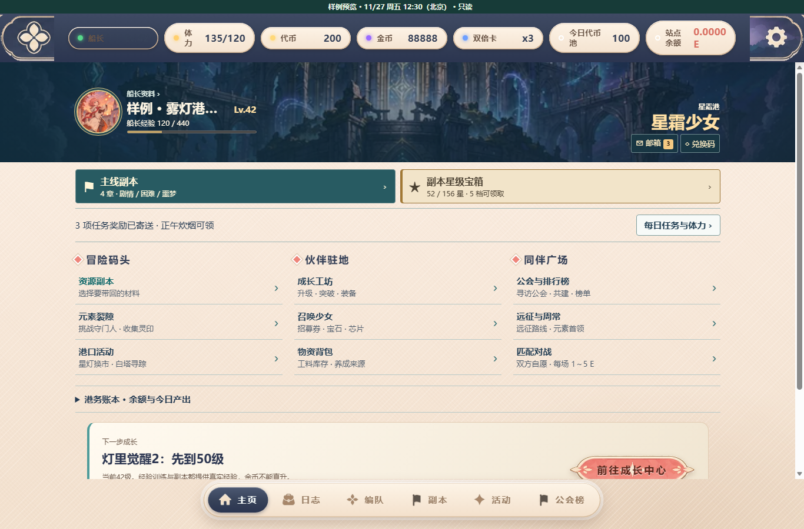
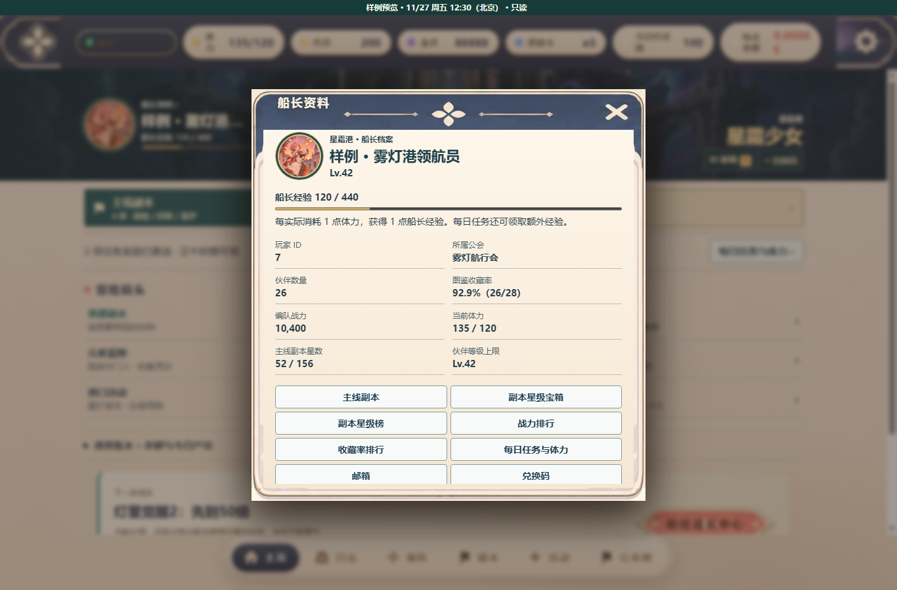

### 副本与星级奖励

地图、顶部资源栏、章节切换、左下三档难度与右下星箱按参考关卡布局呈现。点开星箱可查看所需星数与附件奖励；资源副本集中展示六类材料来源。

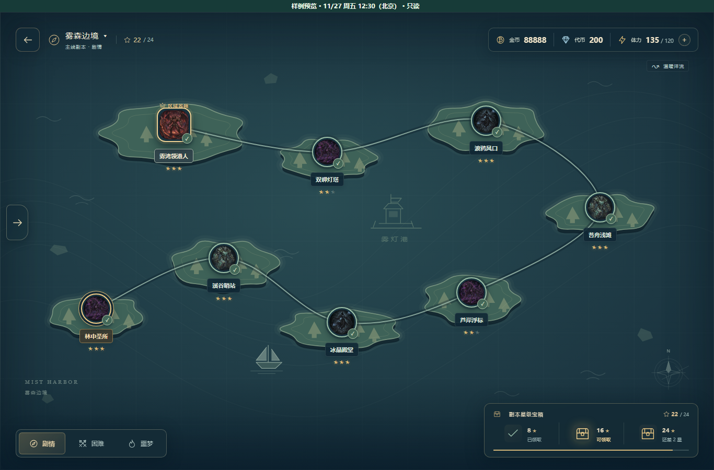
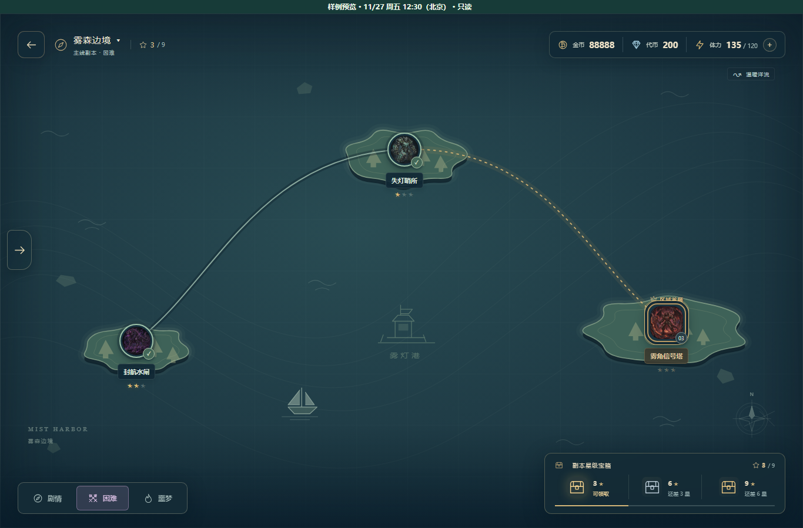
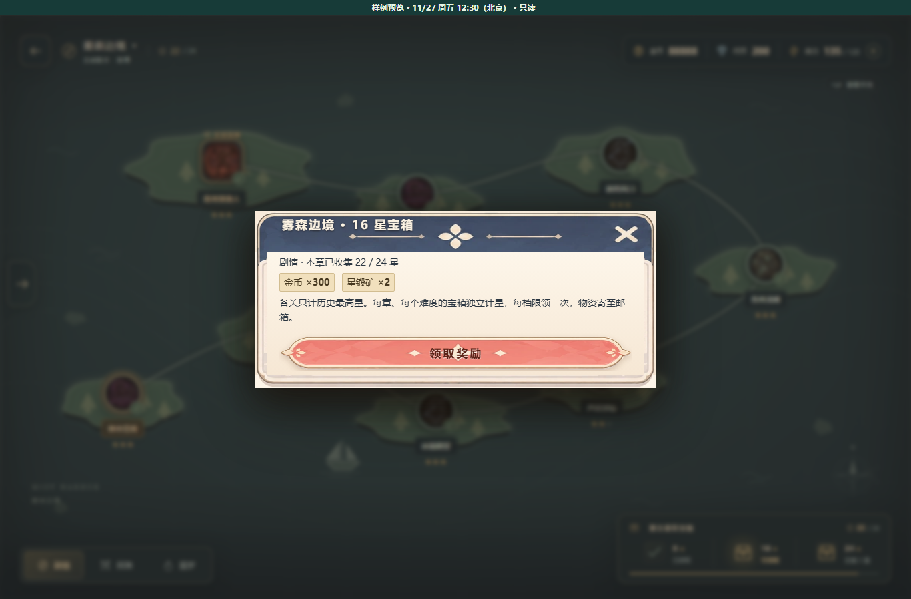
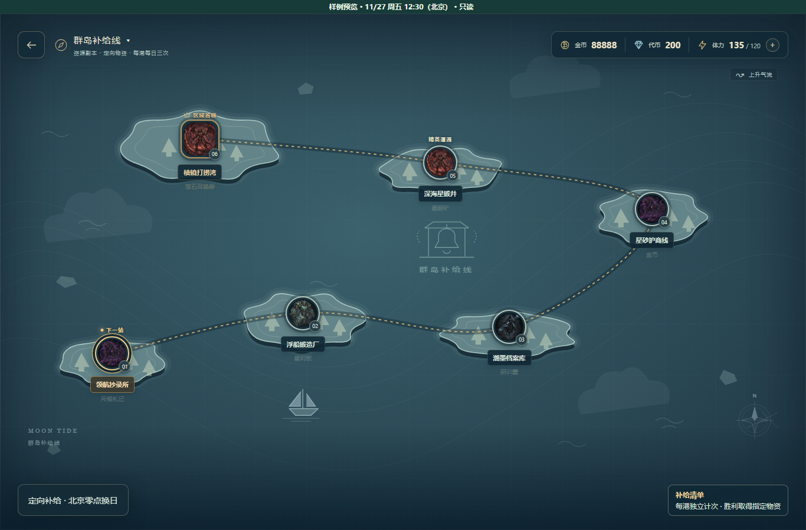

### 排行榜、邮箱与礼包

演示榜使用虚构船长与本地角色立绘，展示排名、星数与队伍；邮箱统一展示待领附件，兑换礼包通过邮件领取。

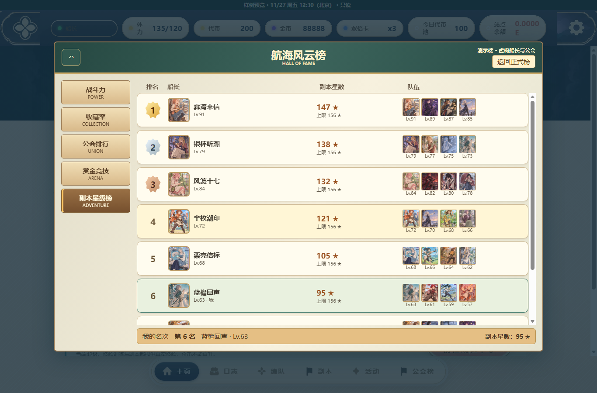
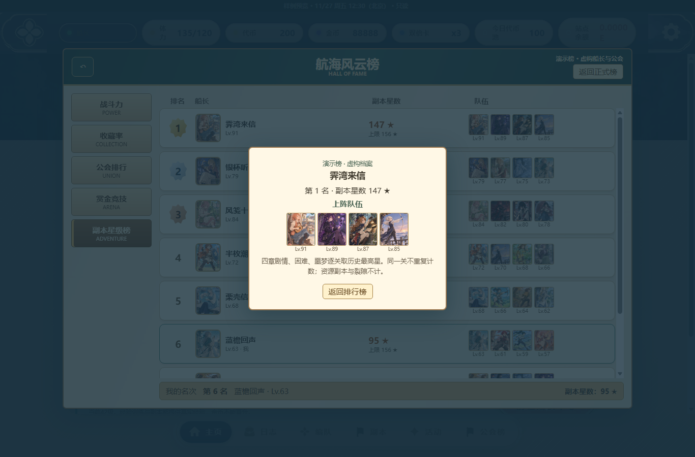
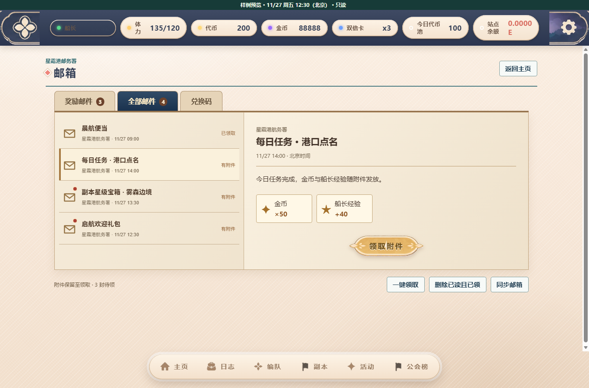
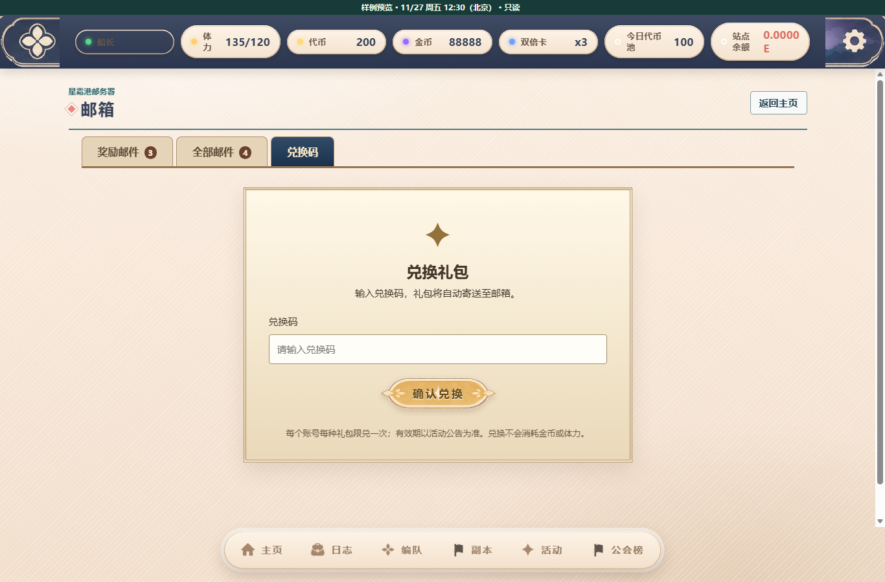

### 手机版界面

手机尺寸保留主页经验展示与副本难度、星级奖励入口。

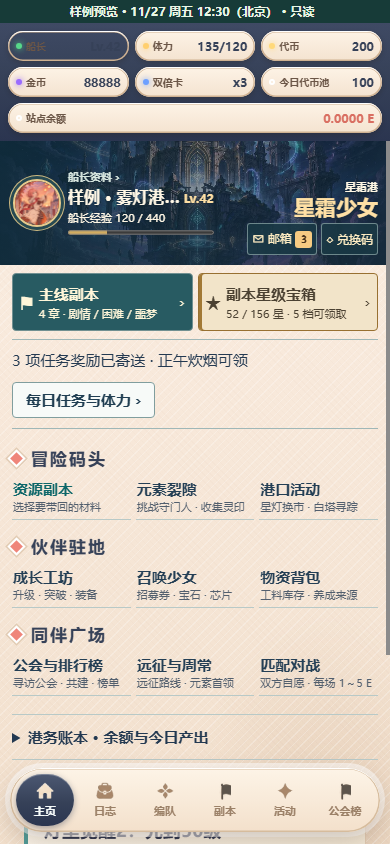
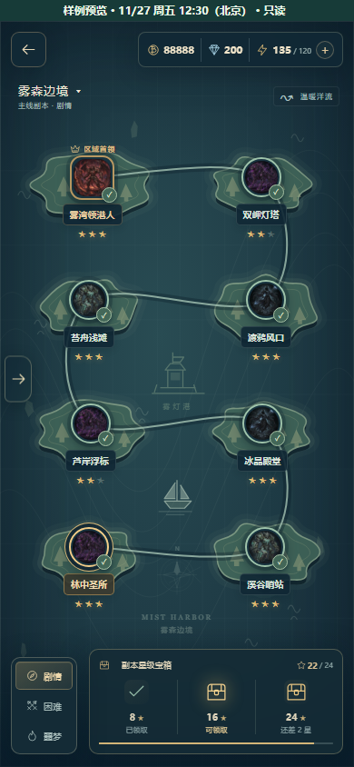

## 接入与验证

此次提交包含游戏界面、游戏模型、控制器与接入示例。新旧存档、经验、附件、兑换记录、星数与排行均由已认证的游戏服务保存；部署时需配套更新后端游戏文件与索引。

验证结果与未运行的宿主检查见 [VALIDATION.md](../../VALIDATION.md)，接入步骤见 [backend/INTEGRATION.md](../../backend/INTEGRATION.md)，副本布局对应关系见[界面实现说明](dungeon-layout.md)。本地截图与演示用于查看 UI，不代表生产服务已经部署。
